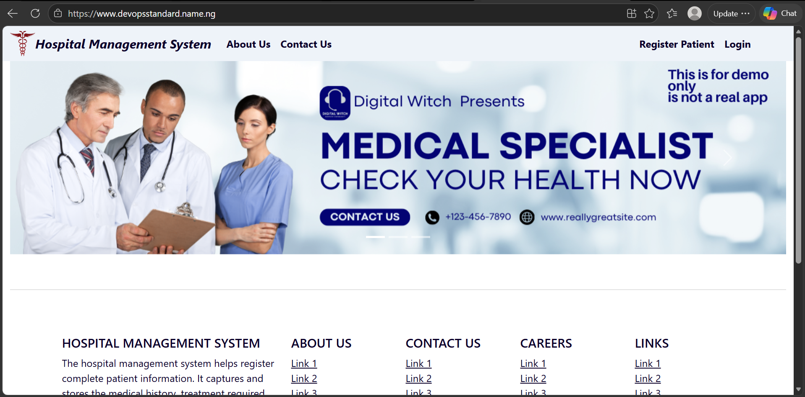
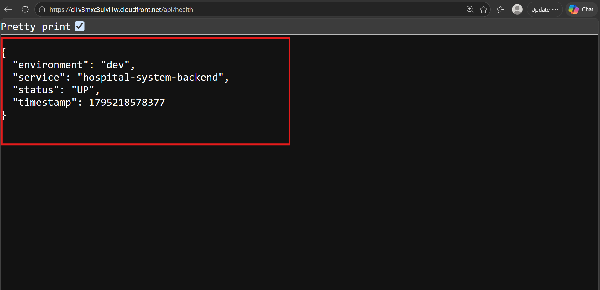
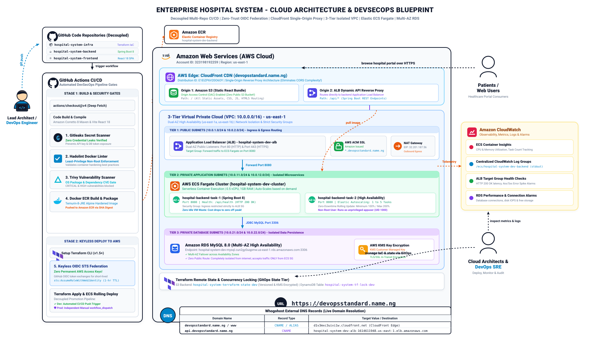

# 🏥 Hospital Management System - Frontend Web Portal (React & AWS CloudFront)

[](https://react.dev/)
[](https://aws.amazon.com/s3/)
[](https://aws.amazon.com/cloudfront/)
[](https://www.docker.com/)
[](https://github.com/features/actions)

> **Modern Single-Page Application (SPA)** for the hospital management platform, built with React 18, securely hosted on Amazon S3, and globally distributed via Amazon CloudFront with modern Origin Access Control (OAC).

---

## 🔗 Hospital System Ecosystem

This repository is the frontend user interface layer of the decoupled three-tier hospital architecture:

| Repository | Tech Stack | Role |
| :--- | :--- | :--- |
| [🏗️ `hospital-system-infra`](https://github.com/Dubemphil/hospital-system-infra) | Terraform, AWS (VPC, ECS, RDS, CloudFront, KMS, OIDC) | Core Cloud Infrastructure & Security Foundation |
| [☕ `hospital-system-backend`](https://github.com/Dubemphil/hospital-system-backend) | Spring Boot (Java), MySQL, Docker, Maven | RESTful Healthcare API & Business Logic |
| [⚛️ `hospital-system-frontend`](https://github.com/Dubemphil/hospital-system-frontend) | React 18, HTML5/CSS3, Single-Page App | Patient & Staff Interactive Web Portal |

* **Live Web Portal**: [https://www.devopsstandard.name.ng](https://www.devopsstandard.name.ng)



* **Live Direct CDN**: [https://d1v3mxc3uivi1w.cloudfront.net](https://d1v3mxc3uivi1w.cloudfront.net)
* **Backend API Health Check**: [https://d1v3mxc3uivi1w.cloudfront.net/api/health](https://d1v3mxc3uivi1w.cloudfront.net/api/health)


---

## 🏛️ Architecture & Runtime Overview

<p align="center">
  
</p>

## 🏛️ Single-Origin CloudFront Architecture (Zero CORS)

The frontend leverages a **Single-Origin CDN routing pattern** via Amazon CloudFront. This architectural choice routes static assets and dynamic API requests through a single domain, completely eliminating cross-origin resource sharing (CORS) security issues and browser preflight latencies:

```mermaid
flowchart TD
    Browser([User Web Browser / Mobile])

    subgraph AWS_Cloud["Amazon Web Services (Edge & Cloud)"]
        subgraph CDN["Amazon CloudFront Global CDN"]
            Router{CloudFront Routing Path}
        end

        subgraph Storage_Tier["Static Content Tier"]
            OAC[Origin Access Control - OAC]
            S3[(Amazon S3 Private Bucket\nReact Production Build\nZero Public Access)]
        end

        subgraph API_Tier["Dynamic API Tier"]
            ALB[Application Load Balancer]
            ECS[AWS ECS Fargate\nSpring Boot Backend]
        end
    end

    Browser -->|HTTPS Request: example.com| Router
    Router -->|Path: /* (Static Assets)| OAC --> S3
    Router -->|Path: /api/* (Dynamic REST)| ALB --> ECS
```

---

## 💻 Key User Portals & Features

* **Patient Portal**:
  - Medical specialist discovery and filtering by clinical discipline.
  - Interactive appointment booking and scheduling with automated validation.
  - Appointment history and consultation review.
* **Physician / Doctor Portal**:
  - Daily schedule dashboard with patient details and contact information.
  - Clinical consultation management and treatment status updates.
* **Hospital Administration**:
  - Medical practitioner profile onboarding and credential management.
  - System-wide consultation assignment and resource allocation.
  - Patient directory and demographic records.

---

## 🛡️ Enterprise CI/CD Pipeline

The GitHub Actions workflow (`.github/workflows/frontend-ci-cd.yml`) automates build verification and cloud deployment:

1. **Gitleaks Secret Scanner**: Analyzes every pull request and push to ensure zero secrets or tokens are committed.
2. **Deterministic Build**: Compiles the React production bundle using Node.js 18 with cached dependencies.
3. **Keyless AWS STS Authentication**: Authenticates securely via **GitHub OpenID Connect (OIDC)**—**no long-lived AWS credentials**.
4. **Amazon S3 Delta Synchronization**: Deploys updated bundles with `aws s3 sync build/ s3://${S3_BUCKET} --delete` to prune obsolete hashes.
5. **Global CDN Edge Invalidation**: Automatically invalidates CloudFront edge caches (`/*`) ensuring users immediately receive updated frontend releases without cache staleness.

